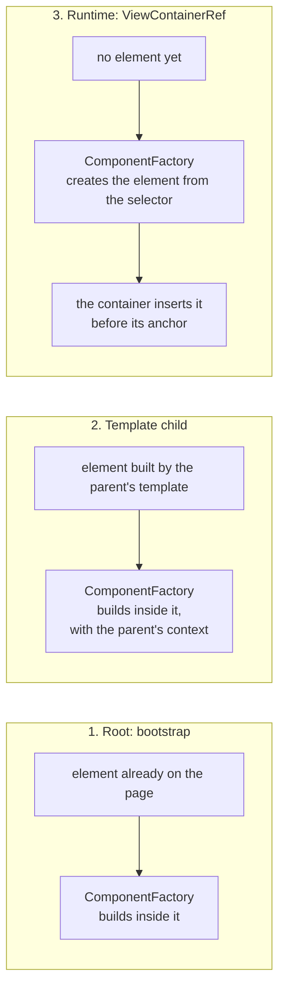
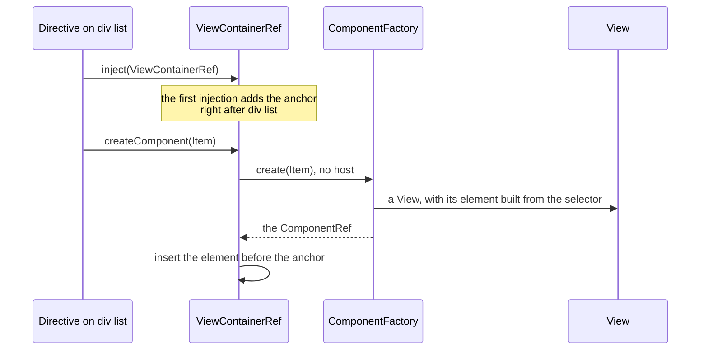
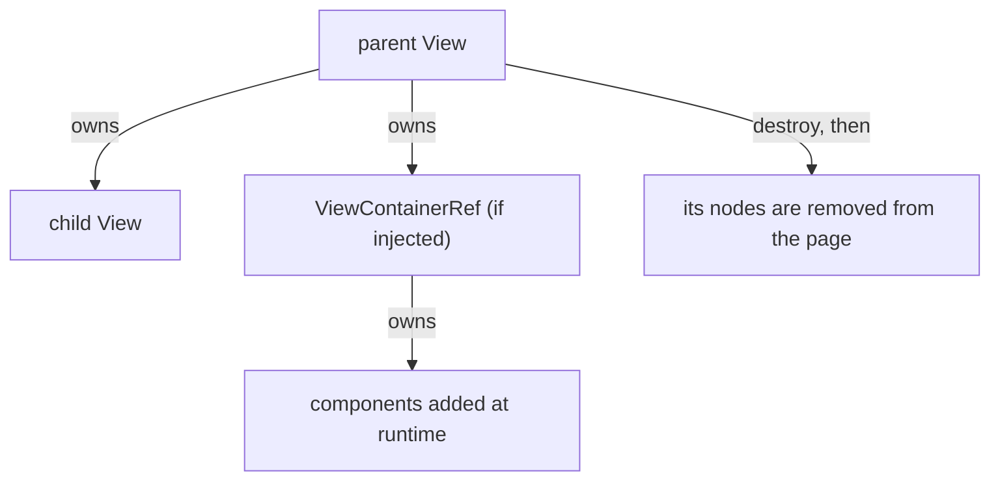

# How the view layer fits together

This page explains how the view layer creates and owns components. It is
meant for someone reading the code for the first time. Diagrams are Mermaid,
which GitHub renders.

## Public and internal

Client code sees a few objects. Everything else is internal.

| Public | What it is for |
|---|---|
| `bootstrap` | Starts an app and returns its `AppRef` (`root`, `destroy()`). The engine behind it is internal. |
| `ComponentRef` | The handle of a component: `instance`, `host`, `setInput`, `subscribe`, `emit`, `destroy()`. |
| `ViewContainerRef` | Adds, moves and removes components at runtime. |
| `ElementRef` | The element a component or directive is on (`host`, `nativeElement`). |
| `viewChildren` | A signal of the instances of a type in the component's template, in document order. `{ read: ElementRef }` gives their elements instead. |
| `viewChild` | A signal of the first of those, as a `Maybe` (none when there is none). `{ read: ElementRef }` works here too. |
| `viewChild.required` | The same, as the instance itself. Reading it when the template has none throws `ViewChildMissingError`. |

| Internal | What it is for |
|---|---|
| `View` | The interface the factories and containers work with: destroy callbacks, inputs, elements, destroy. |
| `ComponentView` | A component's template, on the host element the author wrote: its nodes, element contexts, and one reactive watch. |
| `EmbeddedView` | A block's template, after an anchor comment: its top-level nodes and its own watch. |
| `ComponentFactory` | Builds a component: its injector, its template, its `ComponentView`. |
| `TemplateBuilder` | Builds one template's DOM and its bindings, and creates the components and directives in it. |
| `DirectiveFactory` | Creates the directives of one element, with the element's injector. |
| `ElementContext` | What is on one element: its directive instances, and at most one child `ComponentView`. |

`engine.createComponent` is deprecated and will be removed. See
[IMPROVEMENTS.md](../IMPROVEMENTS.md), "The engine's entry points".

## Three ways a component is created

Every component is created in one of three ways. Each one asks
`ComponentFactory` to build it, and differs only in where the component's
element comes from.

1. **Root.** `bootstrap(type)` finds the element on the page that
   matches the component's selector, and renders the component into it. Nothing
   is inserted: the element is already there.
2. **Template child.** A parent's template contains `<tk-item>`. The parent's
   `TemplateBuilder` builds that element first, then creates the component
   inside it, passing the parent context: the parent's injector and the
   parent's view, which owns the child.
3. **Runtime.** A directive injects `ViewContainerRef` on its element, and
   calls `createComponent(type)`. The factory creates the element from the
   selector, and the container inserts it before its anchor, in order.

Only the runtime case uses a container. A template child is built by its
parent's template, and the root fills an element that is already there.

## Where a component's element comes from

`ComponentFactory.create` takes an optional host:

- **With a host**, it builds the component inside that element (cases 1 and 2).
- **Without one**, it creates the element from the component's selector, so
  `tk-item` gives `<tk-item>` and `[item]` gives `
` (case 3).

The factory never inserts the element into the page. Whoever placed the
component does that: the container, for case 3, and the template, for case 2.

## Runtime components and their anchor

A `ViewContainerRef` is a position in the page, marked by a comment node called
its anchor. Each component it holds has its element placed just before the
anchor, in the container's order.

The container doesn't create the element and doesn't create the anchor on its
own: the factory builds the element, and the directive's element creates the
anchor when a directive first injects the container. Nothing is added to the
page for an element that never injects its container.

## Who owns what

Each view owns the things created for it, and destroying the owner destroys
them. The owner is the view whose template contains the element:

- A child component is owned by its parent's view.
- A runtime component is owned by the view of the directive that injected the
  container. When that view is destroyed, the container clears its components
  and removes its anchor.
- The root component is owned by nothing: destroy it through its `ComponentRef`.

## View queries

Each component has a `ViewQueries` registry, provided in its own injector. The
template builder records each directive and component instance it creates, with
the element it sits on, and removes it when its owning view is destroyed. Embedded
views (`@if` branches, `@map` rows) record into the same registry, since they
belong to the component's template. A child component's template records into its
own registry, so `viewChildren` never lists the items inside a child.

`viewChildren(type)` reads the registry in document order. A `@map` that moves
its rows tells the registry, which then sorts again.

Not built yet: template reference variables (`#name`), `viewChild` (a single
match), and content queries (`contentChildren`).

## Template references

`#name` on an element declares a value for the template: the native element.
It is read like an `@let`, as `name.tagName` (not `name()`), and it is the same
element whether or not a directive or component is on it. In the component's own
template a reference can be read before its element, since bindings read it when
they update. A branch of `@if`, `@match` or `@map` copies the references declared
above it when it is built, so it cannot read one declared after the branch.
Two more forms reach the directives and component on the element:

- `#name="exportAs"`: the instance of the directive, or the component, whose
  `exportAs` metadata is that name. Each directive and component declares its
  own `exportAs`, so a template names what it wants.
- `##name`: the component on the element, as sugar for that. The element itself
  is still `#name`.

An `exportAs` that no directive on the element has, and `##` on an element with
no component, are errors. These references are set once the directives on their
element exist, so they are read in bindings after that, not while the element is built.

## Glossary

- **Host**: the element a component is rendered into. Its `ElementRef` is
  `ComponentRef.host`.
- **Anchor**: the comment node that marks a container's position in the page.
- **Parent context**: what a component gets from the component it sits in: the
  parent injector and the parent view (`ParentContext` in the code).
- **Slot content**: the children of a component's element, which its `<slot>`s
  show.

## Notes for reading the code

- **Two kinds of injector.** A component has its own injector, which is a child
  of its element's injector, or of the engine's for a root. Each element with
  directives has an element injector, shared by its directives.
- **One reactive watch per view.** A view's watch updates its template's
  bindings, and the host bindings of its child components on their elements.
- **Elements with nothing on them are plain.** An element gets an
  `ElementContext` only when a directive, a component or an event binding is on
  it.
