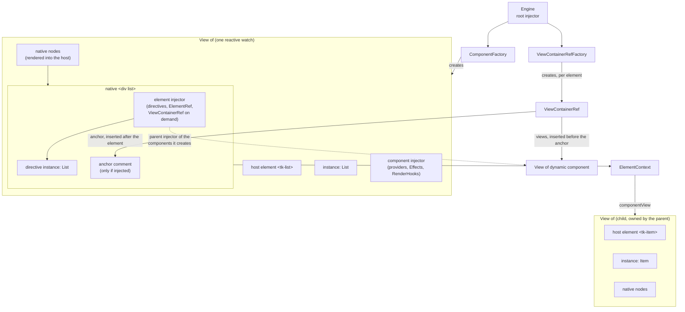
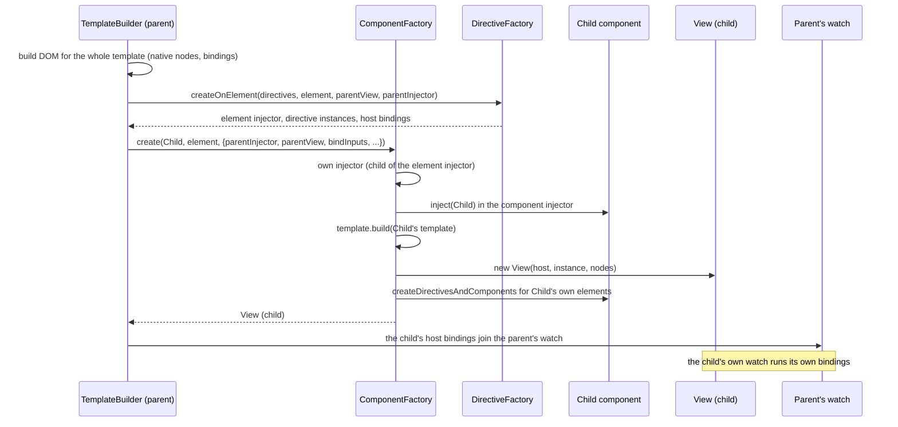
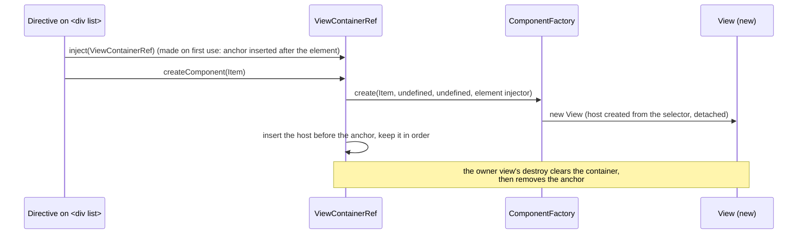
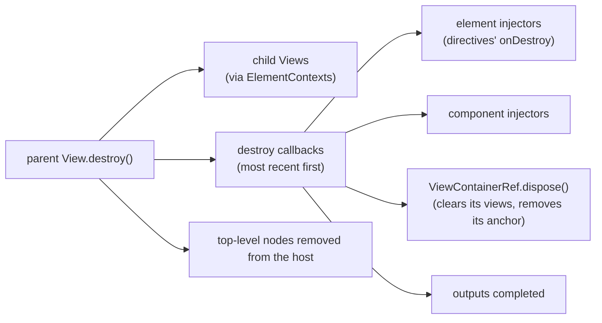

# How the view layer fits together

This page shows how the objects of the view layer relate at runtime: components,
directives, the DOM nodes they render, the `View` that owns each rendered
component, and the `ViewContainerRef` that adds views later. The diagrams are
Mermaid, which GitHub renders.

## The objects

| Object | What it is | Where |
|---|---|---|
| `Engine` | Creates components and containers, and owns the root injector. | `src/view/engine.ts` |
| `ComponentFactory` | Creates a component: its injector, its template, its `View`. | `src/view/factories/component-factory.ts` |
| `TemplateBuilder` | Builds one template's DOM and collects its bindings, then creates the directives and child components of its elements. | `src/view/factories/template-builder.ts` |
| `DirectiveFactory` | Creates the directives of one element, with the element's injector and its host bindings. | `src/view/factories/directive-factory.ts` |
| `ComponentRef` | The public handle of a created component: `instance`, `host`, `setInput`, `subscribe` and `emit` for public members, `destroy()`. Returned by `engine.createComponent`, `engine.bootstrap` and `ViewContainerRef.createComponent`. | `src/view/component-ref.ts` |
| `View` | Internal. One rendered component: its host element, its instance, its DOM nodes, its element contexts, and one reactive watch. | `src/view/runtime/view.ts` |
| `ElementContext` | What Tinker put on one DOM element: its directive instances and, at most, one child `View`. | `src/view/runtime/element-context.ts` |
| `ViewContainerRef` | A place in the DOM, marked by an anchor comment, where views are added, moved and removed. | `src/view/runtime/view-container-ref.ts` |
| Injectors | A tree: the engine's, one per component, one per element with directives. | `src/di/` |
| Native nodes | The DOM elements, text and comments, made through the `Renderer`. | `src/view/renderer.ts` |

## Structure at rest

Each component has one `View`. Each element of its template that has a
directive, a component or an event binding has an `ElementContext`. A child
component is a `View` of its own, held by the `ElementContext` of its host
element, and owned by the parent's `View`.

Read it like this: the `Engine` owns the factories. A component's `View` holds
the native nodes it rendered, and an `ElementContext` for each element that has
something on it. A `ViewContainerRef` has no nodes of its own beyond its anchor;
the views it holds are placed next to that anchor.

## Creating a component in a template

The parent's `TemplateBuilder` builds the DOM first, then creates the
components of its elements, in template order, so a parent is always
created before its children.

## Creating a component at runtime

A `ViewContainerRef` creates components the same way, with no template in
between: the host element is created from the selector, and the container
inserts it before its anchor.

## Who destroys what

Destroying a `View` destroys, in order: the views of the components on its
elements, its own destroy callbacks (most recent first), and then its top-level
nodes. Those callbacks are where the rest is cleaned up.

## Notes for reading the code

- **Two kinds of injector.** A component has its own injector, child of its
  element's (for a component in a template) or of the engine's. Each element with
  directives has an element injector, shared by its directives, child of the
  enclosing element's. A `ViewContainerRef` created at an element uses that
  element's injector as the parent of the components it creates.
- **One reactive watch per view.** The parent's watch updates its own bindings,
  including the host bindings of its child components on their host elements.
  A child's watch updates the child's template.
- **Elements are the unit of "something on it".** An element gets an
  `ElementContext` only when a directive, a component or an event binding is on
  it. A plain element has no context and no injector.
- **Anchors cost nothing until used.** The comment that marks a container is
  inserted the first time a directive injects its `ViewContainerRef`.
